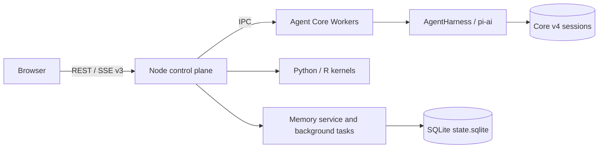

<div align="center">
  
  <h1>Pi-Science</h1>
  <p><strong>An open scientific AI workbench for research, computation, and reproducible discovery.</strong></p>
  <p>
    Chat with AI agents, run scientific code, inspect data, manage reviewed memory,
    and trace every generated artifact back to its source.
  </p>
  <p>
    <a href="README.zh-CN.md">简体中文</a>
    · <a href="#quick-start">Quick Start</a>
    · <a href="#architecture">Architecture</a>
    · <a href="#development">Development</a>
  </p>
  <p>
    
    
    
  </p>
</div>

---

Pi-Science brings AI conversations, scientific computation, data previews and reviewed memory into one local workbench.

- **Run analyses in context.** Execute Python/R code on session kernels and inspect the resulting tables, plots and files alongside the conversation.
- **Keep execution evidence.** Runs record code, environment revisions, artifact hashes and provenance so results can be inspected and reproduced.
- **Research in Conversation.** The Auto Research skill guides dynamic subquestions, independent review and task-specific evaluation, with saved checkpoints and runtime tool budgets.
- **Check scientific citations.** Search papers and scientific data, open the source behind a citation, and inspect the passages the agent recorded when writing its answer.
- **Explore workspace files.** Native read-only `ls`, `glob` and `grep` discover files and search text with bounded output and `.gitignore` support. Enabled on Linux and macOS (with the native directory backend built); linked, hidden, sensitive and protected paths are excluded. See [tool limits and platform status](docs/workspace-discovery-tools.md).
- **Use ordinary project folders.** Research files stay in your workspace. Model requests and external connector calls use the services you configure.

Conversations run concurrently in isolated Agent Core Worker processes. AgentHarness owns execution and durable sessions; Pi-Science adds the scientific workspace and product interface.

## Quick Start

### Requirements

- Node.js **24.16+** with npm. The installer bootstraps the repository-pinned **pnpm 11.7.0** without a global install.
- Git to clone the source. Python, R and Micromamba environments are provisioned on demand when scientific computation is used.
- An LLM API key, or a configured local endpoint such as Ollama or LM Studio
- On Windows, PowerShell **5.1+**

Clone the repository:

```bash
git clone https://github.com/Garhorne0813/pi-science.git
cd pi-science
```

On macOS/Linux, install and start in one step:

```bash
bash scripts/dev.sh
```

Or install once and start separately:

```bash
bash scripts/install.sh
bash scripts/start.sh
```

On native Windows, use PowerShell:

```powershell
powershell -File scripts/install.ps1
powershell -File scripts/start.ps1
```

Open **http://127.0.0.1:8787**. Connect a provider in **Settings → Models** and choose the default for new conversations in **Settings → Agent**. Then open a workspace and start a conversation. Use **Settings → Skills** to manage skills, **Settings → MCP** to enable scientific connectors, and **Settings → Web access** to configure built-in search and fetching. Paper Search is enabled initially. The control-plane API uses the same port.

Linux/WSL requires `ripgrep`, `socat` and `bubblewrap` (Debian/Ubuntu: `sudo apt-get install ripgrep socat bubblewrap`). Installation, startup and `pi-science doctor` check these tools and run an offline Bubblewrap namespace probe. Missing dependencies or blocked namespaces stop installation/startup with a diagnostic.

MCP processes in the Linux sandbox access the network through the policy HTTP/HTTPS proxy, which resolves destinations on the host. General DNS is unavailable inside the sandbox: a hidden `/etc/resolv.conf` or a failed `socket.getaddrinfo()` alone does not indicate that MCP requests cannot reach the network. Built-in search tools use this proxy directly. Custom MCP clients must also support `HTTP_PROXY`/`HTTPS_PROXY`; DNS failures on the host itself require fixing the host resolver.

The installer builds the server, Agent Workers and frontend. Default startup runs **compiled JavaScript** and serves the frontend from the control plane on one port; Vite and tsx are not used at runtime. Bash supports macOS/Linux and WSL; native Windows does not require Git Bash. Installation includes the Agent Core SDK through workspace dependencies.

### Start, diagnose and stop

The installer provides a `pi-science` command. On macOS/Linux, add `~/.local/bin` to `PATH` if needed (`PI_SCIENCE_BIN_DIR` overrides that directory). On Windows, open a new terminal after installation updates `PATH`.

```text
pi-science                 Start the production build (port 8787)
pi-science start --dev     Start source code and Vite (port 5173)
pi-science install         Install dependencies and rebuild
pi-science doctor          Diagnose production prerequisites
pi-science doctor --dev    Diagnose development prerequisites
pi-science logs            Print runtime logs
pi-science status          Show service status
pi-science stop            Stop this checkout's services
pi-science help            Show command help
```

Foreground startup keeps the terminal open; **Ctrl+C** stops the services. Bash also supports `pi-science start --detach`; the Windows launcher is foreground-only.

Re-run the platform installer after moving or updating the checkout to rebuild production artifacts. Source edits take effect immediately only in development mode. To skip installation with the combined Bash launcher:

```bash
PI_SCIENCE_SKIP_INSTALL=1 bash scripts/dev.sh
```

<details>
<summary>Launcher behavior and persistent state</summary>

Production launchers invoke Node directly; npm/pnpm is needed only for installation, builds and dependency updates. `doctor` performs local checks without downloads or persistent database writes: runtime, build/Worker files, dependencies, loopback ports, directory permissions and an in-memory SQLite query. It reports Python/R/Micromamba and LLM configuration as optional setup; persistent SQLite readiness is checked during startup. It checks port availability, so stop a running instance before using it as a pre-start check.

For development, use `pi-science start --dev`, `bash scripts/start.sh --dev`, or `powershell -File scripts/start.ps1 -Dev`. Open Vite on port `5173` for the live frontend. It proxies `/api` to the control plane on `8787`, which can also serve an existing production bundle from `frontend/dist`. Run `pnpm --filter frontend build` to update that bundle. Set `PI_SCIENCE_SERVER_WATCH=1` to opt into `tsx watch`. `PI_SCIENCE_CONTROL_PLANE_PORT` changes the control-plane port, and `PI_SCIENCE_FRONTEND_PORT` changes the Vite port. Both launchers bind the control plane to loopback and use an internal browser cookie, so keep the service local.

The pnpm store is shared between checkouts by default (`${XDG_CACHE_HOME:-~/.cache}/pi-science/pnpm-store` on POSIX, `%LOCALAPPDATA%\pi-science\pnpm-store` on Windows). Set `PNPM_STORE_DIR` to choose an independent cache, including the previous checkout-local `.cache/pnpm-store`. Startup has a 90-second readiness deadline, configurable with `PI_SCIENCE_STARTUP_TIMEOUT_SECONDS`. Launchers track process identity for shutdown and refuse to overwrite an unrelated launcher path. Windows stop checks checkout, executable, entry point, creation time and a per-launch marker; missing or stale state never permits stopping by port alone.

**Updates:** this change does not provide transactional `update`, `rollback`, `uninstall`, or standalone installation packages. Before manually updating source, stop the app and back up application state and workspace data (including SQLite and its WAL files). Re-run the installer after updating. A source downgrade cannot undo database migrations; recovery requires a compatible application version and a full data backup. See [deployment](docs/deployment.md) for verification and the remaining roadmap.

Windows stop failures preserve identity state for retry and exit with code 1. Windows `logs` includes control-plane/frontend stdout and stderr by default; `logs --stderr` selects errors. On POSIX, foreground output stays in the terminal and `logs` reads the detached log. Relative `PI_SCIENCE_FRONTEND_DIST` values are resolved from the checkout root by both the launcher and doctor.

Application state uses `PI_SCIENCE_HOME` or `~/.pi-science`, with a checkout-local fallback when necessary. Project metadata may be workspace-local or application-managed; see [data ownership](docs/architecture.md#persistence-and-data-ownership) before moving or backing up state. Existing v3 sessions can be converted automatically or with the [offline conversion command](docs/agent-core-session-conversion.md).

</details>

## Highlights

| Area | What Pi-Science provides |
|---|---|
| Agent workspace | Streaming conversations, expandable tool details, Markdown, LaTeX, slash commands, and browser questionnaires and approvals |
| Concurrent sessions | Independent Agent Core Worker processes for active, restored, and forked conversations |
| Scientific files | Native previews for molecular structures, FITS, genomics, phase data, 3D models, tables, office documents, media, and code |
| Reproducibility | Live session-scoped execution records, artifact hashes, generating code and diffs, environment snapshots, provenance history, reproduce actions, and artifact references pinned to published versions with text/table/image version diffs |
| Memory | SQLite records, version-bound human review, scoped recall, optional Extraction/Dream, and shared budgets |
| Computation | Shared versioned Micromamba environments, isolated Python/R Session kernels, executable `.ipynb` files, agent notebook cell read/edit/run tools, conversation-linked runs, and an optional app-managed Jupyter Lab |
| Extensibility | Pi skills, prompt templates, MCP servers, subagents, custom model providers, and managed endpoints |
| Workspace safety | Project-scoped metadata, validated paths, isolated session state, and controlled outbound provider discovery |

## Memory

> **Upgrade note:** Memory starts empty; old Ledger / Project Knowledge data is
> retained but not automatically imported. Stop the application and run
> `pnpm export:legacy-memory /absolute/workspace /absolute/new-export.json` for a
> read-only legacy export. Recreate useful entries with verified sources and new
> approvals; legacy approval flags are not reused. See [upgrade steps](docs/unified-memory.md#upgrade-from-ledger--project-knowledge).

Open **Settings → Memory** to configure Memory for the local user across all
projects. Memory and automatic recall start enabled, with smart review. Extraction and
Dream start disabled and have separate switches. Dependent controls expand when
enabled, and changing a switch or trigger mode preserves the stored values.
Configure models, review policy, scheduling and
shared background budgets here. Project/category recall switches stay on the
project's Memory page.

The Memory page has **Memories**, **Pending review** and **Run history** tabs.
Keyword search, status/type/scope/category filters, sorting and 20-record pages
operate on all authorized matches with a matching total. On mobile, filters
open a bottom sheet with draft choices, Reset and Apply controls. Records show a compact preview with an explicit status; expand a record to inspect
its full text, sources, version and history. Edit, archive and delete are in the
more-actions menu. New candidates expose approval/rejection after expansion;
change proposals show current/proposed content. Pending content is excluded from
automatic recall. Smart review permits narrowly validated low-risk preferences;
scientific claims always require approval of the exact version. All-manual queues
all Agent/background changes. Approval means adoption, not scientific proof.

Memory lives in the application SQLite database. It does not rewrite user-owned
workspace files or automatically import old ledger/Project Knowledge data. See
[Unified Memory](docs/unified-memory.md) for scopes, recall, Extraction/Dream,
budget limits, retention and backup.

Project instructions are optional: place an `AGENTS.md` in the workspace root
to provide project background and conventions. You can edit, empty or delete it;
Pi-Science never creates or restores it automatically. Authorized conversation
requests read its current content without storing a second copy in history.
Application rules live separately in `harness/SYSTEM.md`. See
[Agent prompts and workspace instructions](docs/agent-prompts.md).

## Scientific MCP Connectors

Pi-Science includes 18 managed MCP connectors for public scientific data.
They run as local MCP processes and expose typed tools to the agent. Searches
make outbound requests to the listed upstream services.

| Connector | Upstream services | Default |
|---|---|---|
| Paper Search | PubMed, arXiv, Crossref, bioRxiv, medRxiv, Europe PMC | Enabled |
| Literature Graph | OpenAlex | Disabled |
| Clinical Trials | ClinicalTrials.gov | Disabled |
| Structures & Interactions | RCSB PDB, AlphaFold DB, EMDB, IntAct, Complex Portal | Disabled |
| Genes & Ontologies | MyGene.info, EBI OLS, QuickGO, Reactome | Disabled |
| Genomes | Ensembl REST, UCSC Genome Browser | Disabled |
| CellGuide | CELLxGENE CellGuide | Disabled |
| Protein Annotation | InterPro, STRING v12, Human Protein Atlas | Disabled |
| Omics Archives | NCBI GEO, PRIDE, MGnify, ArrayExpress, MetaboLights | Disabled |
| Chemistry | PubChem, ChEBI, BindingDB, Rhea | Disabled |
| Regulation | ENCODE, JASPAR, UniBind | Disabled |
| BioMart | Ensembl BioMart | Disabled |
| Drug Regulatory | openFDA, Drugs@FDA | Disabled |
| Human Genetics | NHGRI-EBI GWAS Catalog, FinnGen PheWAS | Disabled |
| Protein Records | UniProtKB | Disabled |
| Nucleotide Archives | NCBI GenBank, ENA | Disabled |
| Target Discovery | Open Targets Platform | Disabled |
| ChEMBL | ChEMBL | Disabled |

Together they expose 85 tools. Enable the domains you need from
**Settings → MCP**, where you can inspect discovered tools, test a connection,
filter exposed tools, and choose `Ask`, `Allow`, or `Deny` decisions. Built-in
definitions are read-only, while custom `stdio`, Streamable HTTP, SSE, and
socket connectors can also be registered. Settings apply globally, and projects
can override tool decisions. Workers discover tools during initialization and
check current connector and tool policy before a call.

Connector authentication can reference a managed key/token or a named environment variable, delivered as a process variable, HTTP header or Bearer token. Policy snapshots contain only credential references; permitted credentials are resolved in Worker memory. OAuth login/refresh is not currently supported.

`web_search` and `web_fetch` use the pinned `pi-web-access@0.40.0` core in the trusted Worker with public-address, redirect and size checks. Configure them in **Settings → Web access**. Ordinary preferences save automatically, and API keys have a separate update action. See [Web access configuration](docs/web-access-mcp.md).

## Scientific Viewers

Pi-Science renders common research formats directly in the browser.

| Domain | Formats | Viewer |
|---|---|---|
| Chemistry | CIF, PDB, PQR, SDF, MOL, MOL2, SMILES, XYZ, CUBE | Interactive Mol* viewer with structure-linked sequences |
| Astronomy | FITS | Canvas rendering with scientific color maps |
| 3D / CAD | STL, OBJ, PLY, glTF, GLB | Three.js scene viewer |
| Solid-state physics | EIGENVAL, DOSCAR | Band-structure and density-of-states charts |
| Genomics | BED, GFF, GTF, VCF | Track-based genome viewer |
| Tabular data | CSV, TSV | Sortable tables and line, bar, and scatter charts |
| Office | DOCX, XLSX, PPTX | Browser-native document previews |
| General | Markdown, JSON, code, images, PDF, video | Syntax-aware or native previews |

## Architecture



AgentHarness owns agent execution and durable operation state. The Node control plane supervises isolated Workers, projects Core facts into the versioned browser protocol, and coordinates scientific services. Conversations, titles, research and subagents share this execution stack. Memory Extraction/Dream use separate tool-free model calls managed by the control plane.

Core session format **v4** and product SSE protocol **v3** are independent versions. History is a projection of Core sessions; earlier formats are handled only at data-read/conversion boundaries. SQLite owns Memory and coordinates workspaces, environments, jobs and MCP policy. Research files and product metadata have separate storage ownership.

See the [architecture reference](docs/architecture.md) for process boundaries, event delivery, state locations, recovery and capability isolation.

## Slash Commands

Type `/` in the conversation composer to open the command menu.

| Command | Action |
|---|---|
| `/compact` | Compact conversation context |
| `/export <html\|jsonl>` | Export conversation history |
| `/skill:<name>` | Invoke a dynamically discovered workspace skill |

Pi-Science-managed workspaces trust `.pi/skills/` by default; these
project-built-in skills participate in Pi command discovery. Use **Settings →
Skills** to review and control discovered skills.

## Execution Evidence

Kernel, notebook, and agent-tool executions are recorded in the context of the
conversation session that produced them. Execution status streams live, and
the Runs view can locate an execution in its source conversation or open files
and artifacts produced by that execution.

Conversation Workers provide `notebook_read`, `notebook_edit`, and
`notebook_run` for file-backed `.ipynb` notebooks. Cell edits are revision-safe;
`notebook_read` exposes per-cell revisions so `notebook_edit` can protect only
the cells it changes when unrelated concurrent edits should be allowed. Selected
cells run through the same persistent Python/R kernels used by the workbench.
`notebook_run` writes bounded execution counts and outputs back to the notebook
with the next revision, while execution and artifact provenance remain available
through the control plane.

## Model Configuration

**Settings → Models** manages built-in providers, custom OpenAI- and Anthropic-compatible services, and trusted keyless local endpoints such as Ollama or LM Studio. It also manages API keys, explicit environment-variable bindings and subscription authorization for supported providers. Private-network endpoints are allowed by default for local model servers and can be disabled with `PI_SCIENCE_ALLOW_PRIVATE_PROVIDERS=0`. See [native model configuration](docs/model-config-native.md).

**Settings → Agent** saves the default model and thinking level for new conversations. Existing conversations keep their own durable selection, which can be changed from the composer.

## AI Session Titles

After a successfully completed turn, Pi-Science may generate an AI title (**enabled by default**) using the configured **default model**, which can differ from the conversation's model. A disposable Worker with tools and skills disabled sends up to 6 recent messages, each trimmed to 200 characters, and requests a title of at most 8 words.

This is an additional model request containing a conversation excerpt. Titles are stored in `session-titles.jsonl` under the resolved project metadata root; browser storage is an immediate fallback.

To disable it, set the environment variable before starting the services and
restart:

```bash
export PI_SCIENCE_AI_TITLES=0
```

Title generation never blocks the conversation and failures leave the derived
sidebar name in place. Its temporary session remains hidden and is removed
when the Worker is disposed.

## Development

`pnpm dev` (or `pnpm dev:server`) precompiles the Agent Core worker to
`apps/server/.dev-dist/` before starting the control plane. The worker is forked
with plain Node instead of `tsx`, which removes the 5-7s transpile step from every
session start. The mirror is rebuilt automatically when server or contracts
sources change; set `PI_SCIENCE_DEV_WORKER=0` to fall back to `tsx`, or run
`pnpm --filter @pi-science/server build:dev-worker` to precompile without starting.

```bash
# JavaScript and TypeScript tests
pnpm test

# Static checks
pnpm typecheck
pnpm lint

# Production build
pnpm build
```

Additional end-to-end checks:

```bash
pnpm smoke
pnpm uat:conversation
pnpm smoke:agent-core
```

Focused frontend UAT commands:

```bash
pnpm --filter frontend test:uat:memory
pnpm --filter frontend test:uat:notebook
pnpm --filter frontend test:uat:office
pnpm verify:ui --scenario conversation-baseline
```

## Documentation

| Read about | Reference |
| --- | --- |
| Process boundaries, state ownership, events and recovery | [Architecture](docs/architecture.md) |
| Memory setup, review, recall, background runs and retention | [Unified Memory](docs/unified-memory.md) |
| Supported tools and known limits | [Agent Core capability inventory](docs/agent-core-capability-inventory.md) |
| Model providers, credentials and migration | [Native model configuration](docs/model-config-native.md) |
| Existing sessions and offline conversion | [Session conversion](docs/agent-core-session-conversion.md) |
| Scientific connectors, credentials and tool policy | [MCP management](docs/implementation/mcp-management-implementation.md) |
| Research orchestration and deterministic evaluation | [Conversation-native Auto Research](docs/auto-research.md) |
| Writing project skills | [Skill authoring](docs/skill-authoring.md) |

See the [documentation index](docs/README.md) for current guides and the
[implementation documents](docs/implementation/README.md) for feature internals,
design decisions and validation records.

## Contributing

Issues and pull requests are welcome. Before submitting a change, run the relevant tests plus `pnpm typecheck` and `pnpm build`. Changes to runtime behavior should include regression coverage.

## License

MIT

[Documentation index / 文档索引](docs/README.md) · [Development verification / 开发检查](docs/development-quality.md)
