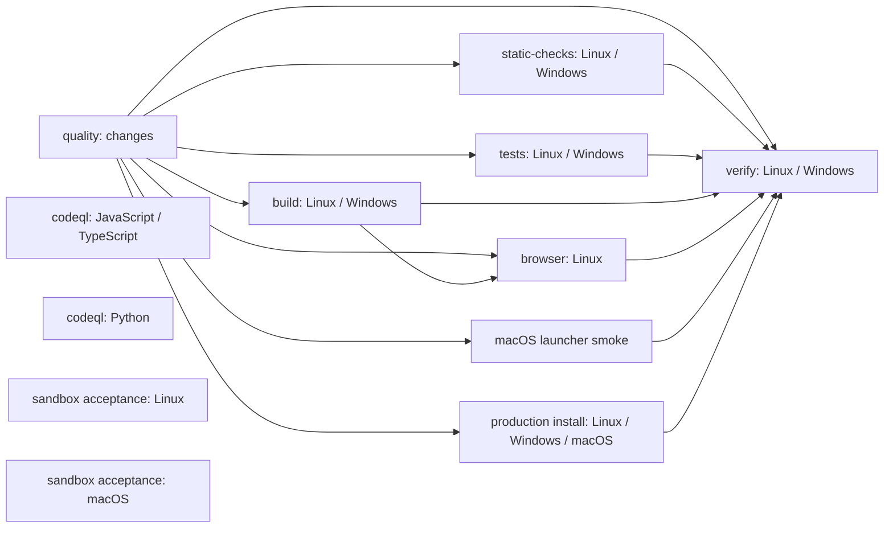

# CI 基线

## 范围和状态

- 配置对应的提交：`0ddb64f7149be41c2aaa103195a948c0918100a5`。
- 本文的配置审计来自该提交的工作流文件。历史运行可能使用不同版本的配置。
- 已采集最近 150 条 PR 工作流运行的 job 结果。时长样本不符合本任务的同一提交运行次数要求。
- 下图只表示配置中的依赖。它不证明哪条路径耗时最长。

## PR job 依赖

`codeql` 与 `quality` 没有工作流内依赖。符合路径条件时，`sandbox acceptance` 也独立运行。各矩阵中的 job 并行。`browser` 等待整个 `build` 矩阵，不只等待产出 `frontend-dist` 的 Linux job。`verify` 使用 `always()`，等待所有列出的依赖结束。

`changes` 输出 `run=true` 时，`quality` 执行其余检查。只有所有变更都在 `docs/` 下，或是仓库根目录的 `README.md`、`README.<名称>.md` 文件时，它才输出 `run=false`。文件列表为空或读取差异失败时，它保守地运行检查。`run=false` 时，其余工作 job 跳过；`verify` 仍执行，并接受相应的跳过结果。

## 触发条件和职责

| 工作流或 job | 触发条件 | 主要职责 |
| --- | --- | --- |
| `quality` | 所有 PR；推送到 `main` | 下列检查的工作流 |
| `changes` | 每次 `quality` 运行 | 检测变更路径 |
| `static-checks` | `changes` 输出 `run=true`；Linux、Windows 矩阵 | 变更分类测试、lint、typecheck、各平台脚本检查 |
| `tests` | `changes` 输出 `run=true`；Linux、Windows 矩阵 | 环境诊断、平台测试、应用和技能测试 |
| `build` | `changes` 输出 `run=true`；Linux、Windows 矩阵 | 构建、冒烟测试和预算检查；Linux 上传前端构建产物 |
| `browser` | `changes` 输出 `run=true`，且 `build` 成功；Linux | 前端 SSE、无障碍、交互和性能检查 |
| `macOS launcher smoke` | `changes` 输出 `run=true`；macOS | 文件读取边界、启动器和原生 Web 工具检查 |
| `production install` | `changes` 输出 `run=true`；Linux、Windows、macOS 矩阵 | 安装、构建和生产生命周期检查 |
| `verify` | `quality` 的依赖结束后；Linux、Windows 矩阵 | 汇总依赖结果 |
| `codeql / analyze` | 所有 PR；推送到 `main`；每周一 `03:23 UTC`；手动运行 | 并行分析 JavaScript/TypeScript 和 Python |
| `sandbox acceptance / sandbox` | PR 修改指定的 server 运行时、沙箱、MCP、依赖或配置路径；手动运行 | Linux 和 macOS 平台隔离验收 |
| `frontend-nightly / visual` | 每天 `02:17 UTC`；手动运行 | 前端视觉回归；不由 PR 触发 |

`sandbox acceptance` 的完整路径列表见 `.github/workflows/sandbox-acceptance.yml`。所有工作流使用同一工作流和 ref 的并发组，并取消该组中被新运行取代的运行。

## 现有缓存与准备步骤

多个 job 使用 `actions/setup-node@v4` 的 `cache: pnpm`。这配置了 pnpm store 缓存，并不表明缓存命中。`production install` 故意不设置 pnpm，以测试从 npm 启动的安装流程。`changes` 的 checkout 使用 `fetch-depth: 0`。其他 checkout 未显式设置该参数。

配置来源：`.github/workflows/quality.yml`、`.github/workflows/codeql.yml`、`.github/workflows/sandbox-acceptance.yml`、`.github/workflows/frontend-nightly.yml`、`.github/scripts/changes.mjs`。

## 运行数据采集

GitHub Actions REST API 的 `GET /repos/Garhorne0813/pi-science/actions/runs?event=pull_request&per_page=100&page=1` 和第二页按返回顺序取前 150 条 workflow run。每条再调用 `GET /repos/Garhorne0813/pi-science/actions/runs/{run_id}/jobs?per_page=100`。没有遇到请求错误或 job 分页截断。样本为 150 条 workflow run，涉及 941 条最新 attempt 的 job；它不是 150 次 PR push。时间窗口是 2026-10-28T07:22:26Z 至 2026-11-03T01:05:51Z。

运行结论：124 success，18 failure，8 cancelled。下表以 job 名称原样分组。失败率分母是 success + failure；cancelled、skipped 和没有创建的 matrix job 不在分母内。verify 的失败包含上游失败的汇总，不能当成独立根因。不同时间的配置和代码混在样本中，旧的 ubuntu-latest 与 ubuntu-24.04 单列。

| workflow / job | success | failure | skipped | cancelled | 失败率 |
| --- | ---: | ---: | ---: | ---: | ---: |
| codeql / analyze (javascript-typescript) | 53 | 0 | 0 | 1 | 0.0% |
| codeql / analyze (python) | 53 | 0 | 0 | 1 | 0.0% |
| quality / browser | 45 | 4 | 3 | 2 | 8.2% |
| quality / build | 0 | 0 | 0 | 1 | 不可计算 |
| quality / build (ubuntu-24.04) | 46 | 1 | 0 | 0 | 2.1% |
| quality / build (ubuntu-latest) | 4 | 2 | 0 | 0 | 33.3% |
| quality / build (windows-latest) | 52 | 1 | 0 | 0 | 1.9% |
| quality / changes | 53 | 0 | 0 | 1 | 0.0% |
| quality / macOS launcher smoke | 52 | 1 | 0 | 1 | 1.9% |
| quality / production install (${{ matrix.os }}) | 0 | 0 | 0 | 1 | 不可计算 |
| quality / production install (macos-latest) | 52 | 1 | 0 | 0 | 1.9% |
| quality / production install (ubuntu-24.04) | 44 | 0 | 0 | 0 | 0.0% |
| quality / production install (ubuntu-latest) | 8 | 1 | 0 | 0 | 11.1% |
| quality / production install (windows-latest) | 50 | 3 | 0 | 0 | 5.7% |
| quality / static-checks | 0 | 0 | 0 | 1 | 不可计算 |
| quality / static-checks (ubuntu-24.04) | 44 | 0 | 0 | 0 | 0.0% |
| quality / static-checks (ubuntu-latest) | 8 | 1 | 0 | 0 | 11.1% |
| quality / static-checks (windows-latest) | 49 | 4 | 0 | 0 | 7.5% |
| quality / tests | 0 | 0 | 0 | 1 | 不可计算 |
| quality / tests (ubuntu-24.04) | 42 | 4 | 0 | 1 | 8.7% |
| quality / tests (ubuntu-latest) | 5 | 1 | 0 | 0 | 16.7% |
| quality / tests (windows-latest) | 44 | 5 | 0 | 4 | 10.2% |
| quality / verify (ubuntu-24.04) | 30 | 13 | 0 | 1 | 30.2% |
| quality / verify (ubuntu-latest) | 5 | 4 | 0 | 0 | 44.4% |
| quality / verify (windows-latest) | 35 | 1 | 0 | 17 | 2.8% |
| sandbox acceptance / Linux Bubblewrap acceptance | 40 | 1 | 0 | 1 | 2.4% |
| sandbox acceptance / macOS Seatbelt acceptance | 36 | 4 | 0 | 2 | 10.0% |

### 同一提交的 job 测量

提交 `c7245242157a93865f2f80a0b88a1d41ebd81b47` 的 [quality 运行](https://github.com/Garhorne0813/pi-science/actions/runs/41571661769) 有 3 次 attempt。下表每行的 job 都在这 3 次中成功。第三次完整工作流失败，因此表格不能用于计算全绿 PR 的总时长。`tests (windows-latest)` 和 `verify` 没有 3 次成功样本，不列成功时长。

每个单元格的格式是 p50 / p95，单位为秒。p95 使用最近秩法；只有 3 个样本时，它等于最大值，不能视为稳定的长期分布。总时长是 job 开始到结束；queue 是 attempt 创建到 job 开始，包含等待上游依赖；setup 是 job 开始到第一个 checkout、install 或 cache 步骤开始。实际工作时间是检查、测试和构建等成功步骤的耗时之和。它不含一般依赖安装、上传和清理。生产安装的脚本无法拆开安装与构建，因此该列包含两者。四列不是可直接相加的完整分段。GitHub 的步骤时间只有秒级精度，0 表示开始与结束落在同一秒。

| job | 总时长 p50 / p95 | queue p50 / p95 | setup p50 / p95 | 实际工作 p50 / p95 |
| --- | ---: | ---: | ---: | ---: |
| `changes` | 10 / 16 | 4 / 13 | 2 / 5 | 0 / 0 |
| `static-checks (windows-latest)` | 111 / 113 | 24 / 27 | 2 / 2 | 42 / 46 |
| `tests (ubuntu-24.04)` | 496 / 497 | 23 / 26 | 3 / 3 | 453 / 460 |
| `build (ubuntu-24.04)` | 110 / 110 | 23 / 26 | 2 / 2 | 74 / 74 |
| `macOS launcher smoke` | 112 / 115 | 22 / 27 | 2 / 3 | 53 / 64 |
| `production install (macos-latest)` | 98 / 110 | 25 / 27 | 2 / 3 | 82 / 89 |
| `production install (ubuntu-24.04)` | 49 / 49 | 24 / 26 | 1 / 2 | 30 / 30 |
| `build (windows-latest)` | 89 / 91 | 24 / 27 | 4 / 4 | 19 / 21 |
| `static-checks (ubuntu-24.04)` | 40 / 50 | 23 / 27 | 2 / 2 | 18 / 24 |
| `production install (windows-latest)` | 86 / 88 | 24 / 27 | 2 / 2 | 66 / 67 |
| `browser` | 234 / 255 | 129 / 136 | 3 / 13 | 200 / 222 |

实际工作步骤按名称分类：`Detect`、`Test`、`Lint`、`Typecheck`、`Check`、`Probe`、`Build`、`Verify native`、`Enforce`、`Run control`、`Run frontend`、`Run workspace`、`Install and build`。这些分类用于说明 job 在做什么；它们不能替代端到端 PR 耗时。历史失败率和缓存命中率见下表及后文，不与这 3 次测量混合计算。

复核方法：分别读取 GitHub REST API 的 `GET /repos/Garhorne0813/pi-science/actions/runs/41571661769/attempts/{attempt}` 和 `GET /repos/Garhorne0813/pi-science/actions/runs/41571661769/attempts/{attempt}/jobs?per_page=100`，其中 `{attempt}` 为 `1`、`2`、`3`。按上述口径计算 API 返回的时间。

### 准备和主要检查步骤

下表使用同一提交的 3 次 `quality` attempt。每个单元格单独计算 p50 / p95，单位为秒。p95 使用最近秩法。不要把不同步骤的 p50 相加，当成 job 总时长的 p50。`Setup Node` 包含 Node 准备；使用 pnpm 缓存的 job 也在该步骤恢复缓存。API 的步骤时间不能直接将两者拆开，日志中的恢复区间另列如下。Windows tests 的三个准备步骤在 3 次均成功，但第三次整个 job 失败。

| job | Checkout | Setup Node | Install JavaScript dependencies |
| --- | ---: | ---: | ---: |
| `changes` | 2 / 3 | 5 / 5 | 不适用 |
| `static-checks (ubuntu-24.04)` | 1 / 2 | 10 / 11 | 5 / 6 |
| `static-checks (windows-latest)` | 8 / 11 | 33 / 34 | 16 / 18 |
| `build (ubuntu-24.04)` | 1 / 2 | 9 / 10 | 6 / 7 |
| `build (windows-latest)` | 6 / 7 | 34 / 34 | 18 / 18 |
| `tests (ubuntu-24.04)` | 1 / 2 | 11 / 11 | 6 / 6 |
| `tests (windows-latest)` | 5 / 6 | 23 / 27 | 11 / 11 |
| `macOS launcher smoke` | 3 / 4 | 24 / 32 | 22 / 22 |
| `browser` | 2 / 4 | 11 / 12 | 6 / 7 |
| `production install (ubuntu-24.04)` | 1 / 4 | 5 / 5 | 不适用 |
| `production install (windows-latest)` | 6 / 7 | 9 / 9 | 不适用 |
| `production install (macos-latest)` | 3 / 3 | 7 / 9 | 不适用 |

对使用 pnpm 的 job，还可以先按每次运行相加 `Checkout`、`Setup pnpm`、`Setup Node` 和 `Install JavaScript dependencies`，再计算分位数。这个和不包含步骤间空隙、其他准备步骤或上传。3 次缓存均命中。

| job | 四个步骤之和 p50 / p95，秒 |
| --- | ---: |
| `static-checks (ubuntu-24.04)` | 17 / 20 |
| `static-checks (windows-latest)` | 60 / 63 |
| `build (ubuntu-24.04)` | 17 / 20 |
| `build (windows-latest)` | 61 / 61 |
| `tests (ubuntu-24.04)` | 19 / 20 |
| `macOS launcher smoke` | 50 / 60 |
| `browser` | 22 / 22 |

生产安装没有单独的 `Install JavaScript dependencies` 步骤。安装与构建合在一起：Linux、Windows、macOS 分别为 `27 / 27`、`54 / 56`、`74 / 83` 秒。

| 成功的检查步骤 | p50 / p95，秒 |
| --- | ---: |
| Linux lint | 4 / 6 |
| Linux typecheck | 7 / 10 |
| Windows lint | 7 / 7 |
| Windows typecheck | 10 / 11 |
| Linux tests 的主测试步骤 | 426 / 431 |
| browser accessibility | 107 / 120 |
| browser sidebar interaction | 48 / 53 |

这 3 次中，8 个使用 pnpm store 缓存的 job 各有一次缓存日志，共 24 份；24 份均显示恢复成功。其中 3 份属于 Windows tests，该 job 的第三次运行失败。日志不能证明缓存来自 `main`。这是同一 PR 的首次运行和重跑，不能代表其他 PR 的冷启动。

### 缓存恢复区间

同一提交的 3 次运行日志中，以下 job 的 pnpm store 缓存均命中。表中时间是日志 `Cache hit for:` 到 `Cache restored successfully` 的时间差，用作下载与解压区间的代理值。它不包含命中提示前的缓存查询。该区间已包含在上表的 `Setup Node` 步骤内，不能再次相加。它也不能单独证明缓存比冷安装更快。每格为 p50 / p95，单位为秒，p95 使用最近秩法。

| job | 恢复区间 p50 / p95 |
| --- | ---: |
| `static-checks (ubuntu-24.04)` | 4.72 / 5.77 |
| `static-checks (windows-latest)` | 20.30 / 20.69 |
| `build (ubuntu-24.04)` | 4.22 / 5.07 |
| `build (windows-latest)` | 20.35 / 20.64 |
| `tests (ubuntu-24.04)` | 4.95 / 5.77 |
| `tests (windows-latest)` | 13.98 / 17.36 |
| `macOS launcher smoke` | 18.04 / 23.14 |
| `browser` | 4.26 / 5.93 |

Windows tests 的 3 次缓存恢复均成功，但第三次 job 后续测试失败。

### pnpm 缓存命中

在上述 150 条工作流运行的 941 个最新 attempt job 中，421 个 job 包含 `Setup pnpm` 步骤。421 份日志均可读取：358 次恢复缓存，63 次未找到缓存。按这些 job 计，命中率为 85.0%。这个比率不包括旧 attempt、未执行该步骤的 job 或其他缓存。它不是按 PR 或不同 cache key 计算的命中率。

| job | 恢复次数 / 运行次数 |
| --- | ---: |
| `macOS launcher smoke` | 44 / 53 |
| `static-checks (ubuntu-24.04)` | 35 / 44 |
| `static-checks (windows-latest)` | 44 / 53 |
| `build (ubuntu-24.04)` | 38 / 47 |
| `build (windows-latest)` | 44 / 53 |
| `tests (ubuntu-24.04)` | 38 / 47 |
| `tests (windows-latest)` | 44 / 53 |
| `browser` | 50 / 50 |
| `static-checks (ubuntu-latest)` | 9 / 9 |
| `tests (ubuntu-latest)` | 6 / 6 |
| `build (ubuntu-latest)` | 6 / 6 |

`browser` 依赖 `build`。它的命中率不能单独代表冷启动的命中率。日志中的 `Cache restored from key` 记为恢复，`pnpm cache is not found` 记为未找到。

### 同一提交样本约束

把 150 条 run 按 `head_sha + workflow name` 分组，没有任何组达到 3 条独立 run。仅 1 条 run 报告 `run_attempt=2`；jobs 集合默认只返回最新 attempt。基于这批数据不能满足同一个 commit 至少运行 3 次的要求。因此不报告 queue、setup、run、总时长的 p50/p95，也不把混合提交的时长分位数当成基线。需要取得同一提交至少 3 次真实的完整运行，且分别保存每次 attempt 的 jobs 和步骤。

API 中每个 job 的 `started_at`、`completed_at` 和 steps 的开始、结束字段可用。用户定义的 queue 是 run 创建到 job 开始；对于依赖其他 job 的 job，这个数字包含等待上游完成，不能直接视作 runner 排队。setup 按要求是 job 开始到第一个 checkout/install/cache restore 步骤开始，不包含这些步骤本身。按配置区分 lint、typecheck、test、build 和其他步骤，不能把剩余总时间全算成工作时间。失败或取消的步骤不代表完整耗时。

### 缺口

- 缓存统计只覆盖最新 attempt 的 `Setup pnpm` 日志。旧 attempt 和其他缓存尚未覆盖。
- GitHub 的 run 集合可以按事件列出，但样本只有前 150 条 workflow run；没有覆盖一个完整自然月，不能据此计算月运行次数或月消耗。
- GitHub API 中取到的 job 时间不是账单分钟数。尚未取得实际计费记录、免费额度、计费平台系数或账号费用，不能计算月费用。
- 没有同一 commit 的 3 次完整 PR 测量，也没有足够的真实耗时数据证明关键路径。不能用 DAG 结构单独认定最慢链。

### 当前 main 的异常检查

`main` 为 `0ddb64f7149be41c2aaa103195a948c0918100a5`。其 push 触发的 [quality](https://github.com/Garhorne0813/pi-science/actions/runs/41418069659) 和 [codeql](https://github.com/Garhorne0813/pi-science/actions/runs/41418069734) 的结论是 success。该提交的 check-runs 总共 19 个：18 success，1 cancelled。被取消的是定时 [frontend-nightly visual](https://github.com/Garhorne0813/pi-science/actions/runs/41420816359/job/125195639238)。

日志表明 `Run visual regression suite` 执行时收到取消。日志只记录 `The operation was canceled.`，未给出取消原因或取消者。取消之前已有多项 Playwright 测试显示失败，例如 `tests/visual/app-shell.visual.spec.ts:7`、`tests/visual/composer-completion.spec.ts:196`、`tests/visual/settings.spec.ts:6`。运行中断，没有最终失败明细。现有证据不能判定这些失败属于 flaky、环境问题或真实 bug，也不能证明 main 所有检查通过。当前 `main` 缺少部分 Linux 截图基准，包括 `projects-*`、`workspace-landing-*` 和 `conversation-*`。该工作流配置了 `timeout-minutes: 25`，使用一个 worker 跑六个视口。多次取消发生在配置的时间限制附近，但日志未明确说明是谁或什么触发了取消，因此不能据此断定取消根因。没有重试。

## 月消耗与费用

GitHub API 报告，2026-10-01 至 2026-10-31 按创建日期共有 1053 次工作流运行。这个数字包括所有事件，不只是 PR。它不等于 job 次数，也不包括之前创建、在 2026-10 重跑的所有情况。完整 job 分钟数和实际账单尚未取得。

对这 1053 次运行，已读取所有可见 attempt 的 3844 个 job。3827 个 job 同时具有 `Set up job` 开始时间和 job 完成时间，且两个时间都在 2026 年 10 月内。这些可观测区间合计 774020 秒。另有 14 个 skipped job 和 3 个 cancelled job 缺少 setup 时间。这个合计只覆盖已观察的 job，不是完整月用量，也不是账单分钟数。它没有覆盖 2026 年 10 月之前创建、但在 2026 年 10 月重跑的运行。它也没有应用账单取整或平台费率。

仓库是公开仓库。[GitHub 计费说明](https://docs.github.com/en/billing/concepts/product-billing/github-actions)称，公开仓库的标准 GitHub 托管 runner 计算免费。存储和其他服务仍须查看账单。现有数据不足以计算总费用。

## 判断和下一步

阶段 0 尚未完成。`main` 的 push 检查成功，但同一提交的定时视觉检查被取消，且取消前出现测试失败。应先查明这些失败，再确认基线状态。不要重试失败来代替根因调查。

配置存在 `changes → build → browser → verify` 依赖链。它只是候选关键路径。缺少符合约束的 3 次同提交运行，不能判断它是否是最慢链，也不能比较优化收益。

所需补充数据：同一提交的 3 次完整 PR 运行及各 attempt 的 job 和 step；旧 attempt 与其他缓存的日志；覆盖重跑和跨月执行的月度用量；实际账单。当前 `gh` 登录令牌无效。GitHub 连接器已用于创建草稿 PR 和读取公开运行数据。实际账单仍需具备账单读取权限的账号。完成基线后，等待用户确认，再进入阶段 1。

## 补充测量与停止记录

同一提交 `c7245242157a93865f2f80a0b88a1d41ebd81b47` 的 [quality 运行](https://github.com/Garhorne0813/pi-science/actions/runs/41571661769) 的 attempt 1 和 2 通过。attempt 3 的 `tests (windows-latest)` 失败。按停止条件，[PR #228](https://github.com/Garhorne0813/pi-science/pull/228) 已关闭，且没有合并。没有重试失败。

失败发生在 `apps/server/src/model-config/model-config-review-v2.test.ts:51`。测试超时，随后同文件的 `afterEach` 也超时。相同提交的前两次运行通过，所以已观察到间歇性超时。测试会启动本地 HTTP 服务器和真实 worker，等待 worker 初始化与响应，最后关闭 worker、应用和服务器。`afterEach` 删除临时目录。测试的总时限是 `30000 ms`，其中两个串行 worker 请求各自使用 `15000 ms` deadline。总时限还包含服务启动、会话创建、另一个 worker 和关闭。这个设置会压缩其余操作的时间，但日志没有各操作的进度或堆栈，不能证明它触发了本次超时，也不能指出卡住的位置。同一提交的第三次运行中，失败测试之前和之后的多个测试文件也变慢。更早的 [Windows 测试运行](https://github.com/Garhorne0813/pi-science/actions/runs/41553188257/job/125646313404) 也记录了同一测试和清理超时，说明这不是本 PR 首次出现的问题；该运行还存在其他失败，不能认定它们同因。日志没有 CPU、磁盘或操作级追踪。不能确定是测试、runner 环境还是产品问题。[失败日志](https://github.com/Garhorne0813/pi-science/actions/runs/41571661769/job/125714771755)。`verify` 的失败是上游结果汇总。不能把这三次当作全绿的 PR 时长基线。

`codeql` 的两个分析 job 各自运行 3 次，均成功。补测以单 job 触发，不能代表整套 PR 工作流的并行状态。下表时间单位为秒。p95 用最近秩法；3 个样本的 p95 是最大值，不能代表稳定的长期分布。总时长是对应 attempt 创建到 job 完成。queue 是 attempt 创建到 job 开始；setup 是 job 开始到 checkout 开始；run 是 `Perform CodeQL analysis` 步骤的耗时。三段不覆盖所有步骤。

| job | 总时长 p50 / p95 | queue p50 / p95 | setup p50 / p95 | run p50 / p95 |
| --- | ---: | ---: | ---: | ---: |
| `analyze (python)` | 59 / 60 | 4 / 4 | 1 / 3 | 32 / 33 |
| `analyze (javascript-typescript)` | 68 / 84 | 3 / 3 | 2 / 2 | 43 / 59 |

`quality` 前两次通过的运行中，最后完成的工作 job 均为 `tests (windows-latest)`，随后 `verify` 汇总结果。这是已观察到的候选关键路径。第三次失败，尚不能确认全绿基线的 p50 和 p95。

## 一次性 Windows 诊断

用户批准后，在诊断提交 `9dba1b86` 上增加了阶段与资源日志，并只运行一次已失败的测试。原有 Linux 和 macOS 沙箱检查保留，且均通过。诊断只选择目标测试；它不能替代原来的完整测试套件。GitHub Actions [诊断运行](https://github.com/Garhorne0813/pi-science/actions/runs/41588073876)，[Windows job 日志](https://github.com/Garhorne0813/pi-science/actions/runs/41588073876/job/125758123333)。

目标测试本次通过，没有复现超时。阶段日志显示，在这一次运行中，会话创建是记录到的最长单个阶段；worker 关闭、会话关闭、应用关闭、服务器关闭和临时目录清理均有完成记录。`session.create` 内部还包含工作区准备、文件复制、启动子进程、等待初始化和后续 IPC。现有日志没有这些内部步骤的起止，不能确定本次等待具体发生在哪一步。这只描述本次运行，不能证明前次超时发生在会话创建，也不能排除整套测试的前序状态和负载影响。

日志中的 `inFlight` 字段误把部分 heartbeat 名称当作尚未结束的阶段。因此本次分析只采用明确的阶段 begin/end 记录，不把该字段当作资源泄漏证据。本次 `finally` 结束后才开始 `afterEach`，没有观察到清理重叠；失败运行没有对应日志，不能据此推断当时的顺序。资源采样汇总了所有同名 Node 进程，不能当作目标进程的连续资源曲线。诊断代码已在提交 `7c4adbc8` 中撤销，没有保留对测试断言、超时或 CI 检查的修改。
