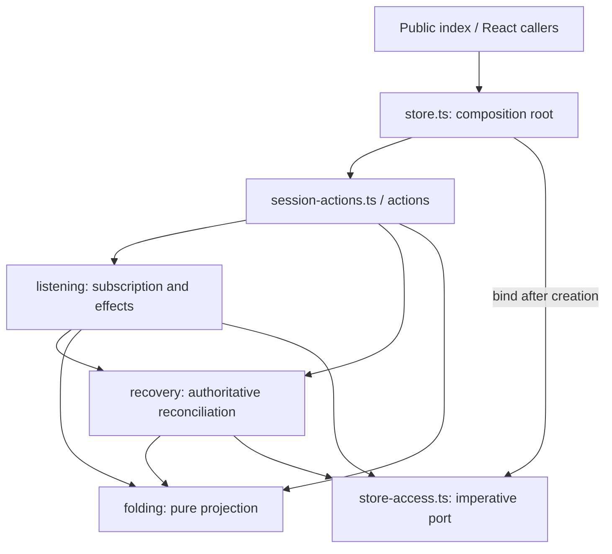

# Frontend agent runtime

Components use `frontend/src/lib/agent-runtime/index.ts`. The existing
`event-fold.ts`, `recovery.ts` and `listener.ts` APIs remain compatibility
facades; `session-actions.ts` composes typed action groups. Protocol code imports
the implementation that owns each operation instead of importing those facades.
The server remains authoritative for execution and durable history.

## Dependency boundaries

The imperative port exposes only Zustand `getState` and `setState`. It creates no
second store. `store.ts` binds it after constructing the initial state and action
groups, so internal modules do not import the composition root. The port follows
a new binding during development hot reload. State access must happen inside
operations, never during module initialization. Runtime value imports form an
acyclic graph; type-only dependencies do not initialize modules.

| Layer | Modules and responsibility | Boundary |
| --- | --- | --- |
| Composition | `store.ts`, `store-access.ts`, `types.ts`, `session-actions.ts` | One observable store; compose actions once with the same set/get handles |
| Actions | `actions/connection.ts`, `prompt.ts`, `prompt-delivery.ts`, `history.ts`, `commands.ts`, `sessions.ts` | Capture workspace/session/generation ownership before async work |
| Event folding | `folding/reducer.ts`, `product-event.ts`, `message-events.ts`, `tool-events.ts`, `runtime-events.ts`, `artifact-events.ts` | One copy-on-write transaction dispatches to one event family; no I/O or store access |
| Replay and identity | `folding/versioned-event.ts`, `ownership.ts`, `identity.ts`, `state.ts`, `types.ts` | Sequence waterlines and revision logs stay scoped to their thread and content owner |
| History projection | `folding/history-conversion.ts`, `history-window.ts`, `narration.ts`, `artifacts.ts` | Preserve paged history, timing, request identity and artifact anchors |
| Recovery | `recovery/runtime-state.ts`, `connection.ts`, `gap.ts`, `settled-history.ts`, `prompt-monitor.ts`, `missing-session.ts` | REST busy/idle is authoritative; shared bounded workers reject stale results |
| Listening | `listening/subscription.ts`, `transport.ts`, `interactions.ts`, `lifecycle.ts`, `projection.ts` | One subscription; preserve effect order and applied-cursor decisions |
| Background effects | `listening/watchdog.ts`, `titles.ts`, `runs-signal.ts`, `missing-session.ts`, `binding.ts` | Timers and in-flight work remain owned by their protocol and current client |

`history-window-recovery.ts` coordinates fetching older pages around a new tail.
`generations.ts` retains the shared connection, conversation, activity,
local-mutation, history-window and presentation-metadata fences. Session lists,
names, replacement and interaction queues remain focused helpers at the root.

## Event dispatch order

1. `subscription.ts` rejects another session's event and handles approval-mode
   notifications. Transport chatter does not reset the watchdog silence clock.
2. Run invalidation is signalled, then transport/session-replacement boundaries
   and optimistic missing-session retries are handled. A server gap withholds
   cursor acknowledgement while authoritative recovery runs.
3. Interaction payloads update their separate state dimension. Lifecycle effects
   deliberately use the state snapshot captured **before** those mutations,
   preserving the original event's ownership and busy/terminal guards.
4. Every remaining record reaches the fold, including malformed questionnaires
   and interactions that cannot build a card. Such records still consume a
   stream position.
5. Projection gaps request the bounded recovery worker and return `false` to
   withhold the applied SSE cursor. Replayed/speculative pending records also
   withhold it until the missing positions are reconciled.

## State ownership and lifetimes

| Owner | State | Lifetime |
| --- | --- | --- |
| `actions/connection.ts` | Connect deduplication map | One composed action set; cleared on target change/disconnect |
| `actions/history.ts` | Cursor-scoped in-flight page requests | Shared module map; connection transitions clear it; completed requests retire their own entry |
| `actions/sessions.ts` | Pending session creation | Shared map keyed by workspace and connection generation |
| `actions/commands.ts` | Pending interaction responses | Shared map keyed by workspace, session and request |
| `recovery/runtime-state.ts` | Authoritative busy observations and suppressed intentional disconnects | Weak maps scoped to client, then workspace/session |
| `recovery/connection.ts` | Restore and connection-loss demands | One worker per client/workspace/session and captured generations, with one shared four-probe budget |
| `recovery/gap.ts` | Gap rebase rounds | One bounded worker per workspace/session; repeated requests join it |
| `listening/binding.ts` | Active client and unsubscribe callback | One binding; replacing the client unsubscribes the old listener |
| `listening/watchdog.ts` | Silence timer and pending REST probe | One timer; reads current binding/state at tick time and validates generations after awaiting |
| `listening/titles.ts` | Pending title generation | One in-flight request per workspace/session with the existing retry marker |
| `Thread.foldState` | Content ownership, sequence waterline, pending/speculative events and terminal runs | Per thread; authoritative projection reset clears reducer bookkeeping |

A prompt action records local request identity before submitting it. Ambiguous
delivery is reconciled against persisted status. Busy/error REST responses never
imply the composer is idle. History reconciliation retains paged history and
checks generations again after fetching or merging. Artifact/stat changes use
presentation metadata generations without invalidating unrelated conversation
work.

Do not duplicate a protocol's maps or timers when extracting helpers. Keep
components on the public entrypoint, keep folding pure, and import internal
operations from their owning leaf module.

## Validation

Run `pnpm --filter frontend exec vitest run src/lib/agent-runtime --maxWorkers=2`
for reducer, restore, replay, generation-fence, pagination, interaction,
watchdog, session replacement and store-rebinding regressions. Run the full
frontend suite for component/client callers and `pnpm --filter frontend build`
for type checking and production bundling. After subscription changes, run
`pnpm --filter frontend test:sse-budget` against that build to verify the real
browser connection lifecycle, plus `pnpm --filter frontend test:bundle`.

See [architecture](architecture.md), [recovery development records](archive/prd-pr112-sse-recovery-v2.md)
and [verification](development-quality.md).
