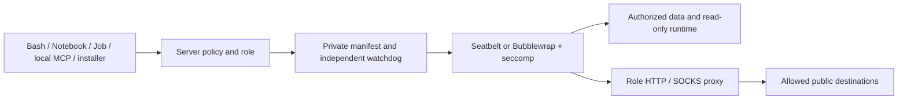

# Role-based process sandbox

The execution layer uses server-selected role
policies feed a common process launcher, OS restrictions constrain filesystem
and network access, and host-owned proxies enforce outbound allowlists. It uses
the existing pinned `@anthropic-ai/sandbox-runtime@0.0.79` backends: Seatbelt on
macOS and Bubblewrap plus seccomp on Linux. Missing isolation refuses execution.

## Execution boundaries

| Profile | Callers and filesystem scope | Host grants | Default network |
| --- | --- | --- | --- |
| `analysis` | Bash, Python Notebook, background Jobs; workspace data writable, runtime dependencies read only | Explicit read/write directories | None |
| `mcp` | Local stdio MCP servers, including discovery/probes; workspace data writable, installed server/dependencies read only | Explicit read/write directories | None |
| `install` | Environment service creating one new revision; only that prefix and package cache writable | None | Conda-forge, Anaconda, PyPI and Python file hosting over HTTPS |
| `control` | Environment health-check helpers; installed prefix read only, private scratch writable | None | None |
| `byoc` | Provider-helper factory; frame workspace and stage writable, SDK read only | None | Only the registered HTTPS endpoint, intersected with the operator BYOC allowlist |
| `candidate` | Budget-bound candidate `input` readable and `work` writable | None | Always none |

Profiles are internal policy values. Tool arguments, workspace settings, request
environment variables and HTTP surface labels cannot choose a role or grant
runtime dependencies. Candidate policy cannot be widened to another profile.
`providerHelperPolicy` binds each helper to one server-registered public HTTPS
endpoint; missing endpoints have no network and unapproved endpoints fail.
Provider registration UIs, remote schedulers and new remote-service adapters are
not added by this change; adapters can use this factory for their local helpers.



## Operator configuration

Set `PI_SCIENCE_SANDBOX_PROFILES` on the server to a canonical absolute path to
a private, operator-owned, single-link JSON file (mode 0600). Keep it outside
all writable workspaces and host grants. Workers receive this path only through
trusted launch configuration. No configuration file is required for offline
analysis or the default environment-install repositories.

Example (replace directory examples with existing canonical directories):

```json
{
  "schemaVersion": 1,
  "userReadPaths": ["/srv/research/reference-data"],
  "userWritePaths": ["/srv/research/approved-results"],
  "profiles": {
    "analysis": {
      "allowedDomains": ["eutils.ncbi.nlm.nih.gov", "rest.uniprot.org"],
      "deniedDomains": []
    },
    "mcp": {
      "allowedDomains": ["eutils.ncbi.nlm.nih.gov", "api.crossref.org", "www.ebi.ac.uk"]
    },
    "install": {
      "allowedDomains": ["conda.anaconda.org", "pypi.org", "files.pythonhosted.org"]
    }
  }
}
```

A missing port means HTTPS port 443. An explicit port permits that destination
port; `*.example.org` matches subdomains only. Bare `*`, IP literals, localhost,
local names, unknown fields and unsupported role keys are rejected. Specifying
`install.allowedDomains: []` disables package network access. Deny rules take
precedence, including the built-in blocks on common exfiltration destinations.
Sensitive files and persistence paths remain denied within host grants.

Profile contents contribute to the policy digest. Changed configuration changes
kernel identity; a stale admission fails before process startup. Existing
running processes keep their original OS policy and proxy until stopped. Stop
active workloads before revoking grants. The existing shared
`PI_SCIENCE_SANDBOX_READ_POLICY` independently bounds dependency reads and protects
service-owned data.

## Network and credentials

Every launch owns HTTP and SOCKS proxies with its immutable role policy. Linux
uses SRT's Unix-socket/socat bridge into a fresh network namespace; macOS permits
only the assigned proxy ports. Raw outbound, arbitrary loopback access and
arbitrary Unix sockets remain blocked. Proxies pin connections to DNS answers
checked by SRT's resolved-address guard; host proxy environment is not inherited.

HTTP requests use validated absolute authorities. CONNECT and SOCKS tunnels
require a bounded TLS ClientHello whose SNI equals the approved destination.
Malformed, missing or encrypted ClientHello names are refused. SOCKS supports
domain-name CONNECT with no authentication, not UDP, raw plaintext tunnels or
IP-literal destinations. HTTPS is tunneled without decrypting application data.
Clients must use the provided proxy variables; applications that bypass them
receive OS denials. Node's environment proxy support is enabled, and the system
CA bundle is copied into private scratch for curl, Python and Node.

General workloads receive a rebuilt environment without model keys or internal
tokens. MCP receives only its own explicit credential bindings. Web Access gets
a bounded snapshot of its own config in private scratch, without access to the
host service state directory. TLS certificate files are public trust material;
connector credentials remain private per-launch data and are cleaned up with
that launch.

## Lifecycle and native file tools

Linux retains PID namespaces, parent-death behavior and the independent Node
watchdog. macOS additionally compiles a small trusted native supervisor into the
private control directory; `/usr/bin/clang` and `/usr/bin/sandbox-exec` are
required. It lives in a separate session, watches owner death and wall time, and
identifies detached descendants through a unique harmless Mach permission in
their inherited sandbox. It checks process start identities before signaling.
The Darwin sandbox query SPI is a platform dependency, not a public stable API.
This remains a same-user application sandbox, not hostile multi-tenant or VM
isolation; resource quotas and kernel exploit resistance are outside its scope.

Darwin native reads use `O_NOFOLLOW_ANY` and stable single-link descriptors.
Native write/edit commits use a confined helper, because Node cannot do Linux's
`/proc/self/fd` directory traversal on macOS. An idle kernel replacing a parent
path therefore cannot redirect a host-side write outside the workspace.
Ordinary writes are capped at 16 MiB. Artifact capture uses the same bounded
descriptor reads. External host-grant writes are not automatically published as
workspace artifacts.

`trusted-host` remains an explicit administrator-selected compatibility backend;
no error or missing dependency switches execution to it. Candidate execution
always requires isolation. Sandboxed R Notebook execution remains disabled
pending its own bridge acceptance. HTTP/SSE MCP endpoints retain their existing
host-side authorization and outbound policy; they are not local subprocesses.

## Verification

Normal tests cover role separation, configuration validation, stale admission,
domain/port boundaries, malformed and fragmented TLS ClientHello, SNI refusal,
native descriptor reads and existing lifecycle behavior. Protocol-only legacy
fixtures explicitly select `trusted-host`; they are not isolation evidence.

Run real acceptance on each supported OS:

```bash
PI_SCIENCE_SANDBOX_TEST=1 \
PI_SCIENCE_SANDBOX_PYTHON_ROOT=/absolute/trusted/python-prefix \
pnpm --filter @pi-science/server exec vitest run \
  src/runtime/sandbox/platform-acceptance.test.ts
```

Linux additionally needs Bubblewrap, socat, ripgrep and user/PID namespace support.
The suite accesses `https://example.com` for allowlisted HTTPS acceptance and
checks that `example.org` is denied. It exercises Bash, Python state, detached
descendants, deadline enforcement, installation writes, real MCP and Jobs.
The sandbox acceptance workflow runs both macOS and Linux. A skipped suite is
not platform acceptance.
