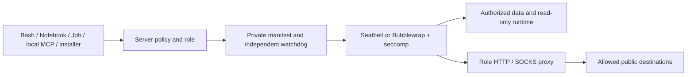

# Role-based process sandbox

The execution layer uses server-selected role
policies feed a common process launcher, OS restrictions constrain filesystem
and network access, and host-owned proxies enforce outbound allowlists. It uses
the existing pinned `@anthropic-ai/sandbox-runtime@0.0.79` backends: Seatbelt on
macOS and Bubblewrap plus seccomp on Linux. Missing isolation refuses execution.

## Execution boundaries

| Profile | Callers and filesystem scope | Host grants | Default network |
| --- | --- | --- | --- |
| `analysis` | Bash, Python Notebook, background Jobs; workspace data writable, runtime dependencies read only | Explicit read/write directories | None |
| `mcp` | Local stdio MCP servers, including discovery/probes; user connectors have workspace access; builtins read installed code/dependencies and write private scratch only | Explicit read/write directories for user connectors only | None |
| `install` | Environment service creating one new revision; only that prefix and package cache writable | None | Conda-forge, Anaconda, PyPI and Python file hosting over HTTPS |
| `control` | Environment health-check helpers; installed prefix read only, private scratch writable | None | None |
| `byoc` | Provider-helper factory; frame workspace and stage writable, SDK read only | None | Only the registered HTTPS endpoint, intersected with the operator BYOC allowlist |
| `candidate` | Budget-bound candidate `input` readable and `work` writable | None | Always none |

Profiles are internal policy values. Tool arguments, workspace settings, request
environment variables and HTTP surface labels cannot choose a role or grant
runtime dependencies. Candidate policy cannot be widened to another profile.
Builtin MCP connectors retain the MCP network profile and live network grants,
but do not inherit workspace, session full-access, operator filesystem grants or
analysis runtime paths. Their working directory is the read-only MCP installation.
Credential glob scans cover only their private scratch directory, so startup does
not traverse the research workspace or nested worktrees. Web Access receives only
its own configuration through the launcher and stores its cache in private scratch.
`providerHelperPolicy` binds each helper to one server-registered public HTTPS
endpoint; missing endpoints have no network and unapproved endpoints fail.
Provider registration UIs, remote schedulers and new remote-service adapters are
not added by this change; adapters can use this factory for their local helpers.



## Operator configuration

Set `PI_SCIENCE_SANDBOX_PROFILES` on the server to a canonical absolute path to
a private, operator-owned, single-link JSON file (mode 0600). Keep it outside
all writable workspaces and host grants. Workers receive this path only through
trusted launch configuration. No configuration file is required for offline
analysis or the default environment-install repositories.

Example (replace directory examples with existing canonical directories):

```json
{
  "schemaVersion": 1,
  "userReadPaths": ["/srv/research/reference-data"],
  "userWritePaths": ["/srv/research/approved-results"],
  "profiles": {
    "analysis": {
      "allowedDomains": ["eutils.ncbi.nlm.nih.gov", "rest.uniprot.org"],
      "deniedDomains": []
    },
    "mcp": {
      "allowedDomains": ["eutils.ncbi.nlm.nih.gov", "api.crossref.org", "www.ebi.ac.uk"]
    },
    "install": {
      "allowedDomains": ["conda.anaconda.org", "pypi.org", "files.pythonhosted.org"]
    }
  }
}
```

A missing port means HTTPS port 443. An explicit port permits that destination
port; `*.example.org` matches subdomains only. Exact RFC1918 IPv4 addresses
with optional ports are accepted. Bare `*`, other IP literals, localhost, local
names, unknown fields and unsupported role keys are rejected. Specifying
`install.allowedDomains: []` disables package network access. Deny rules take
precedence, including the built-in blocks on common exfiltration destinations.
Sensitive files and persistence paths remain denied within host grants.

Profile contents contribute to the policy digest. Changed configuration changes
kernel identity; a stale admission fails before process startup. Existing
running processes keep their original OS policy and proxy until stopped. Stop
active workloads before revoking grants. The existing shared
`PI_SCIENCE_SANDBOX_READ_POLICY` independently bounds dependency reads and protects
service-owned data.

## User-approved network access

Settings → Network manages persistent domain decisions for `analysis` and local
`mcp` independently. Decisions apply to every workspace served by this user’s
server. Public hostname allows grant ClientHello-inspected TCP tunnels on port
443. Exact RFC1918 IPv4 endpoints additionally allow HTTP on their specified
port (default 443). A block without a port
denies the destination on every port; a port-specific block denies that port.
Blocks override configured allows. Removing a decision
restores the operator baseline. Operator and built-in deny rules always win.
Candidate, install, control and BYOC processes do not inherit these decisions.

The main agent exposes `request_network_access({ domain, profile?, reason? })`.
Its browser permission card offers **Always allow**, **Deny this request**, and
**Never allow**. The profile defaults to `analysis`. Candidate and delegated
workers cannot request their own network approvals. Invalid targets, URLs,
wildcards, non-RFC1918 IP literals, invalid ports and internal hostnames are rejected. DNS resolution
is still checked by the existing resolved-address guard at connection time.

Decisions are atomically persisted to the service-owned `network-permissions/grants.json`
in `PI_SCIENCE_HOME`, with cross-process locking and revision fencing. A settings
change while a prompt is pending invalidates that approval. This file and its
parent directory must remain outside writable sandbox grants; file tools cannot
modify it. Corrupt/unreadable state closes access. A running proxy also refuses
a removed or rolled-back ledger instead of silently restoring broader access.

Each eligible launcher reads these decisions before new proxy connections and
checks open connections every 200 ms. Revocations close affected HTTP and SOCKS
connections, while the kernel and its Python variables remain alive. The dynamic
decisions do not change kernel identity. Proxies launched before this feature
must be restarted once to gain this update support. Operator configuration
changes still follow the restart rules above.

The authenticated settings API exposes `GET /api/settings/network`,
`POST /api/settings/network` with `{ profile, domain, decision: "allow" | "deny" }`,
and `DELETE /api/settings/network` with `{ profile, domain }`. The GET response
includes the read-only operator baseline as well as saved user decisions.

## Network and credentials

Every launch owns HTTP and SOCKS proxies with its role policy and, for analysis
and local MCP, the current user-approved network decisions. Linux
uses SRT's Unix-socket/socat bridge into a fresh network namespace; macOS permits
only the assigned proxy ports. Raw outbound, arbitrary loopback access and
arbitrary Unix sockets remain blocked. Proxies pin connections to DNS answers
checked by SRT's resolved-address guard; host proxy environment is not inherited.

HTTP requests use validated absolute authorities. CONNECT and SOCKS tunnels
require a bounded TLS ClientHello. Hostname destinations require matching SNI;
explicitly approved IPv4 destinations can omit SNI. Malformed and encrypted
ClientHello names are refused. SOCKS supports domain-name and IPv4 CONNECT with
no authentication. These are destination-bounded raw TCP tunnels after initial
ClientHello inspection: the proxy neither terminates TLS nor verifies a successful
TLS handshake, and subsequent bytes may be non-TLS. A client must present the
accepted ClientHello prefix before upstream connection; bare plaintext connections
and UDP remain blocked. Normal HTTPS clients validate certificates themselves.
Clients must use the provided proxy variables; applications that bypass them
receive OS denials. Node's environment proxy support is enabled, and the system
CA bundle is copied into private scratch for curl, Python and Node.

General workloads receive a rebuilt environment without model keys or internal
tokens. MCP receives only its own explicit credential bindings. Web Access gets
a bounded snapshot of its own config in private scratch, without access to the
host service state directory. TLS certificate files are public trust material;
connector credentials remain private per-launch data and are cleaned up with
that launch.

## Lifecycle and native file tools

Linux retains PID namespaces, parent-death behavior and the independent Node
watchdog. macOS additionally compiles a small trusted native supervisor into the
private control directory; `/usr/bin/clang` and `/usr/bin/sandbox-exec` are
required. It lives in a separate session, watches owner death and wall time, and
identifies detached descendants through a unique harmless Mach permission in
their inherited sandbox. It checks process start identities before signaling.
The Darwin sandbox query SPI is a platform dependency, not a public stable API.
This remains a same-user application sandbox, not hostile multi-tenant or VM
isolation; resource quotas and kernel exploit resistance are outside its scope.

Darwin native reads use `O_NOFOLLOW_ANY` and stable single-link descriptors.
Native write/edit commits use a confined helper, because Node cannot do Linux's
`/proc/self/fd` directory traversal on macOS. An idle kernel replacing a parent
path therefore cannot redirect a host-side write outside the workspace.
Ordinary writes are capped at 16 MiB. Artifact capture uses the same bounded
descriptor reads. External host-grant writes are not automatically published as
workspace artifacts.

`trusted-host` remains an explicit administrator-selected compatibility backend;
no error or missing dependency switches execution to it. Candidate execution
always requires isolation. Sandboxed R Notebook execution remains disabled
pending its own bridge acceptance. HTTP/SSE MCP endpoints retain their existing
host-side authorization and outbound policy; they are not local subprocesses.

## Verification

Normal tests cover role separation, configuration validation, stale admission,
domain/port boundaries, malformed and fragmented TLS ClientHello, SNI refusal,
native descriptor reads and existing lifecycle behavior. Protocol-only legacy
fixtures explicitly select `trusted-host`; they are not isolation evidence.

Run real acceptance on each supported OS:

```bash
PI_SCIENCE_SANDBOX_TEST=1 \
PI_SCIENCE_SANDBOX_PYTHON_ROOT=/absolute/trusted/python-prefix \
pnpm --filter @pi-science/server exec vitest run \
  src/runtime/sandbox/platform-acceptance.test.ts
```

Linux additionally needs Bubblewrap, socat, ripgrep and user/PID namespace support.
The suite accesses `https://example.com` for allowlisted HTTPS acceptance and
checks that `example.org` is denied. It exercises Bash, Python state, detached
descendants, deadline enforcement, installation writes, real MCP and Jobs.
The sandbox acceptance workflow runs both macOS and Linux. A skipped suite is
not platform acceptance.

CI pins every Linux runner in the quality and sandbox-acceptance workflows to
the Ubuntu 24.04 runner image because `ubuntu-latest` moved to Ubuntu 26.04,
whose AppArmor policy denies the capability the sandbox needs inside its
nested user namespace, so apply-seccomp fails on `/proc/self/setgroups` and
every sandboxed call is refused. The pin is a CI compatibility fix, not
support for 26.04. Hosts that cannot satisfy the sandbox still fail closed.


## Writable operator-config ancestors

`Operator sandbox config has a writable ancestor` means a directory containing
operator configuration allows group or other users to write (for example, mode
`775` or `777` without the sticky bit). A private `600` config file or `700`
immediate parent is insufficient when a higher directory can be replaced.
The error includes the offending directory and its mode.

New application state roots are created with mode `700`, including when the
launcher runs under `umask 002`. Existing directories retain their permissions.
For an existing installation, remove group/other write permission from the
reported directory if you own and administer it (`chmod go-w /reported/path`),
or move `PI_SCIENCE_HOME` (or the explicit operator config) under a trusted
ancestor chain. This check applies to session approval state, network grants,
and sandbox profile configuration; it remains enforced in every approval mode.


## Linux install/start preflight

The POSIX installer checks `rg`, `socat` and `bwrap` before invoking pnpm, and
startup repeats the check before launching services. `pi-science doctor` runs the
same discovery and namespace probe. The probe is offline, has a 10-second timeout,
and runs `/bin/true` with a read-only root in new user, mount, PID and network
namespaces. It verifies Bubblewrap startup; it does not replace the full runtime
acceptance suite above.

Helpers are discovered on the install/start shell's absolute PATH entries and
canonicalized. Explicit `PI_SCIENCE_SANDBOX_RIPGREP`, `PI_SCIENCE_SANDBOX_SOCAT` and
`PI_SCIENCE_SANDBOX_BWRAP` absolute paths take precedence; invalid overrides fail
instead of falling back. The resolved paths are exported to the server and its
workers, so helper discovery still works when the launcher rebuilds PATH.

Missing packages produce installation commands for Debian/Ubuntu, Fedora and
Arch. A namespace failure reports Bubblewrap's error and directs the operator to
host/container namespace and AppArmor policies; no automatic isolation downgrade
is performed. Explicit administrator-selected `PI_SCIENCE_EXECUTION_MODE=trusted-host`
retains its existing compatibility behavior and prints that the preflight is
skipped. macOS is unaffected by this Linux-only check.


## Linux runtime diagnostics and user-installed commands

A session reports bounded, redacted MCP discovery failures in its state. The
conversation shows a collapsible notice when some connectors failed; working
connectors remain available. Authentication values and URL credentials/query
strings are removed before diagnostics reach the browser.

MCP command discovery uses the service operator's PATH, captured separately from
workspace environment overrides. Writable workspace executables and relative PATH
entries are excluded. Node package launchers such as npm/npx use the trusted Node
executable directly and receive a narrow package read grant; uvx symlinks retain
`uv tool run` behavior. Executable dependencies are protected from writes even in
full-access sessions. Command discovery does not grant network access or authorize
package downloads.

Micromamba downloads honor `HTTP_PROXY`, `HTTPS_PROXY` and `NO_PROXY` without
requiring a Node startup flag, while preserving normal TLS certificate validation.
Linux launcher status and doctor distinguish exited zombie processes from live
processes, retain process identity checks, and tolerate a process disappearing
while `/proc` is read.

### Private IPv4 services

Settings → Network and `request_network_access` accept exact RFC1918 IPv4
addresses (`10.0.0.0/8`, `172.16.0.0/12`, `192.168.0.0/16`) with an optional
port, for example `192.168.1.10:8080`. These entries allow HTTP and a
destination-bounded TCP tunnel after TLS ClientHello inspection on that port;
omitting the port means 443. Operator profile
`allowedDomains` and `deniedDomains` accept the same endpoint syntax. Public
hostname approvals remain restricted to ClientHello-inspected tunnels on port 443. IP ranges, loopback, link-local,
metadata addresses and noncanonical IP spellings are not accepted as user grants.

An IP allowance is scoped to analysis or MCP, persists across projects, and
can be revoked while kernels remain running. Denials take precedence. Broad
public HTTPS access does not grant private IP access. A permitted hostname can
resolve to a private address only when that exact IP and port are also allowed.
The ClientHello prefix for an IP literal may omit SNI; hostname tunnels require
matching SNI. After that check the proxy forwards raw TCP bytes without verifying
a TLS handshake. These permissions therefore authorize TCP access to the exact
approved endpoint, not an HTTPS-only protocol boundary. UDP remains blocked.
Settings help and the approval card disclose this scope before access is granted.
