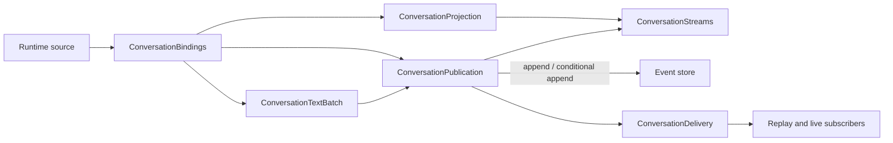

# Server service boundaries

The public classes and route registration functions retain their existing
imports and signatures. Their implementation modules depend on typed ports or
lower-level protocols, rather than importing the facade that composes them.
This refactor preserves persistence formats, route behavior, admission order,
credential ownership and recovery budgets.

## Model resources

`apps/server/src/model-resources/model-resource-service.ts` owns one repository,
credential store, settings store and optional runtime catalog. It creates one
`operations/context.ts` port; each operation module receives a `Pick` of only
the dependencies it needs. Cross-operation callbacks look up the facade method
at call time, so overrides and failure injection continue to affect nested use
cases. Private read/health helpers receive smaller field-only ports.

| Module under `model-resources/operations/` | Owns |
| --- | --- |
| `reads.ts` | Provider/model projections, runtime catalog reads and availability |
| `providers.ts` | Provider CRUD and archived provider adaptation |
| `custom-providers.ts` | Aggregate creation, connection changes, deletion and compensation |
| `endpoints.ts` | Endpoint validation, CRUD, enablement, probing and health updates |
| `bindings.ts` | Provider/endpoint binding CRUD and reference checks |
| `models.ts` | Model overrides, capabilities and deletion |
| `discovery.ts`, `discovery-http.ts` | Prospective probes, discovery, bounded responses and secret redaction |
| `capabilities.ts`, `validation.ts`, `compatibility.ts`, `types.ts` | Pure normalization and compatibility DTOs |

Operations share the facade's exact repository and credential objects. Creating
an aggregate still compensates the resources it created on failure. Deleting or
changing authentication still respects shared endpoint/credential ownership.
`ensureMigrated` remains the archived-tooling no-op; extracting operations does
not reactivate legacy settings migration during normal native model-config use.

## Conversation events

`runtime/events/conversation-event-hub.ts` is a composition root. All state is
per hub instance; there is no shared global publication queue beyond the
existing exported default hub instance.

| Module under `runtime/events/conversation/` | State / boundary |
| --- | --- |
| `streams.ts` | Epoch, sequence and tainted flag for each workspace/session |
| `projection.ts` | Turn identity, accumulated text/thinking and content revisions |
| `publication.ts` | One serial publication chain per workspace/session; conditional guards and persistence failure epochs |
| `delivery.ts` | Subscribers, replay pending queues, deduplication and unresolved interaction replay |
| `text-batch.ts` | Separate pending text/thinking slots and their timers |
| `binding.ts` | Bound/expected-exit sources, observation promises, per-process event order and stderr throttling |
| `records.ts`, `text.ts`, `interactions.ts`, `limits.ts`, `types.ts` | Wire format, UTF-8 limits and payload interpretation |

A non-content record flushes queued text/thinking first. Observation work runs
after that input's normalized records are processed. `flush(cwd)` repeatedly
drains observations, text slots and publication promises for that workspace,
including terminal work enqueued by process exit. It does not wait for another
workspace's unfinished observers.

The publication chain still assigns sequence numbers before append. A cancelled
conditional append can reclaim its sequence. Persistence failure taints the
stream; the next publication rotates its epoch and updates the projection's
turn metadata, retaining the existing live-delivery fallback behavior. Replay
and unresolved interaction state stay together in `ConversationDelivery`.

## Agent sessions

`runtime/agent/agent-core-session-service.ts` retains ownership of the manager,
repository, registry, live/opening/mutation maps, approval retirements and
recovery maps/timers. `session/context.ts` exposes typed operations and live
access to mutable hooks, before-start callbacks and the shutdown flag. Those
values must not be copied into a stale context snapshot.

| Module under `runtime/agent/session/` | Responsibility |
| --- | --- |
| `startup.ts` | Create/open, attach event observers, apply the initial snapshot, then activate |
| `commands.ts` | Prompt/control commands, notifications and model configuration |
| `approval.ts` | Revision checks, capability retirement, persistence and resource revocation |
| `legacy-import.ts` | Validate/copy a legacy transcript before registering ownership or starting a worker |
| `supervision.ts` | Progress deadlines, single-flight recovery, bounded restart attempts and timer cleanup |
| `lifecycle.ts` | Reload, resume/state, fork/delete, stats and orderly shutdown |
| `resources.ts`, `resource-policy.ts` | Worker environment, credential variable names, composer catalog and skill policy |
| `queries.ts`, `identity.ts`, `types.ts` | Ownership/liveness queries, canonical identities and shared state types |

The facade keeps workspace admission and the single per-session mutation lock.
Operation callbacks dynamically dispatch through its methods, preserving the
same lock/recovery state across modules. Runtime binding must apply its first
snapshot before activation. Approval changes retain their verified shutdown
fallback. A watchdog probe must still validate live identity and operation
progress before initiating recovery; successful IPC alone is not progress.

`resource-policy.ts` resolves `harness/AGENTS.md` relative to its deeper source
or compiled directory. The additional path level is intentional; source
worker tests and a compiled policy-load check validate asset resolution after relocation.

## Settings HTTP adapters

`http/routes/settings-routes.ts` registers general settings and delegates skill
HTTP operations to `settings-skill-routes.ts`. `settings-response.ts` shares the
reload/error response adapter and query parsing. Pure skill-policy transforms
live in `catalog/skill-policy.ts`; merged catalog construction lives in
`catalog/managed-skill-catalog.ts` and receives workspace locations from the HTTP
adapter, avoiding a catalog-to-router dependency.

## Validation

Run `pnpm --filter @pi-science/server typecheck`,
`pnpm --filter @pi-science/server lint`, and
`pnpm --filter @pi-science/server test --maxWorkers=2`.
The relevant suites cover publication ordering/guards, observer draining,
replay/backpressure, credentials and compensation, approval transitions,
activation races, migration and watchdog recovery. The session composition
regression checks replacing hooks after attachment through the real composed
hub and its drain boundary.

Build with `pnpm --filter @pi-science/server build`, then run
`node apps/server/scripts/smoke-web-access.mjs`. Run the Settings and provider
credential benchmarks separately from the unit suites:
`node scripts/benchmark-settings.mjs` and
`node scripts/benchmark-provider-credentials.mjs`.

See [architecture](architecture.md), [frontend runtime](frontend-agent-runtime.md)
and [verification](development-quality.md).
